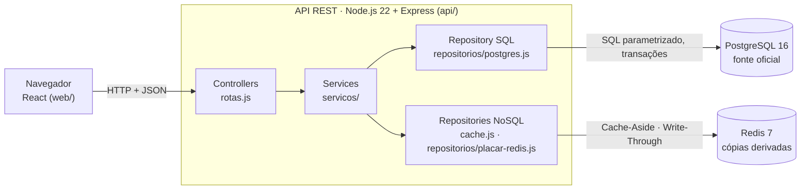
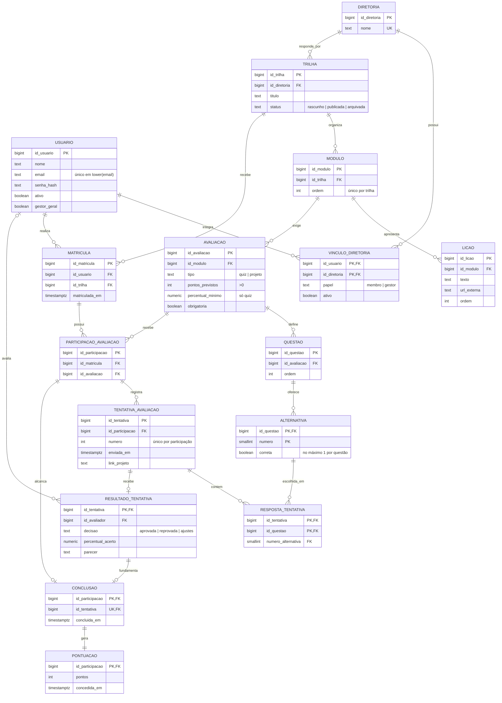

# EJ Quest · Documento de Arquitetura e Modelagem

> Entregável 1 da especificação de Banco de Dados II: diagrama ER (relacional), diagrama de
> coleções/chaves (NoSQL) e justificativa tecnológica da persistência poliglota.
> Versão de 12/11/2026. Fonte da verdade do código: `db/*.sql` e `api/src/`.

## 1. O sistema em uma frase

Plataforma de gestão do conhecimento gamificada para Empresas Juniores: membros seguem trilhas
(módulos, lições, quizzes e um desafio final), gestores avaliam os desafios, e cada aprovação gera
pontos que alimentam um ranking.

## 2. Arquitetura



- **Estilo:** MVC/Layered (seção 3.1 da especificação de BD2), monólito único.
- **Ambiente:** Docker Compose com três serviços (`db`, `cache`, `api`), um comando para subir tudo.
- **Sem ORM** (DEC-003): o que a disciplina avalia (transação, bloqueio, procedure) fica visível no código.

## 3. Modelo relacional (PostgreSQL)

### 3.1 Diagrama ER



### 3.2 Normalização (até a 3FN)

| Forma | Como o modelo atende | Exemplo |
|---|---|---|
| 1FN | Nenhum atributo multivalorado | Cada resposta é uma linha em `resposta_tentativa`, não uma lista numa coluna |
| 2FN | Em chave composta, nada depende de só parte da chave | `papel` depende do par usuário × diretoria; o nome da diretoria mora em `diretoria` |
| 3FN | Sem dependência transitiva | `tentativa_avaliacao` e `pontuacao` não guardam `id_usuario`: ele é alcançado por participação → matrícula |

Totais, percentuais e posições **não são guardados**: são calculados por views. Os dois "fatos
históricos" (`pontuacao.pontos` e `resultado_tentativa.percentual_acerto`) registram o valor no
momento do evento, e não são redundância.

### 3.3 Restrições, objetos programáveis e índice

- **Integridade:** 16 PK, 21 FK (2 compostas), 9 UNIQUE, 22 CHECK, índice único em `lower(email)`
  e índice único parcial (uma alternativa correta por questão). Todas as FK com `ON DELETE RESTRICT`.
- **Views:** `vw_ranking_consolidado`, `vw_progresso_membro`, `vw_fila_avaliacao`.
- **Procedures:** `sp_aprovar_projeto`, `sp_pedir_ajustes`, `sp_enviar_projeto` (bloqueio
  `SELECT ... FOR UPDATE` na participação).
- **Triggers:** `trg_conclusao_pontua` (AFTER INSERT: pontos na mesma transação) e três
  `trg_*_imutavel` (BEFORE UPDATE OR DELETE: histórico imutável).
- **Índice extra:** `idx_tentativa_enviada_em`, escolhido por medição (DEC-010).

## 4. Modelo chave-valor (Redis) · "diagrama de coleções"

O Redis guarda só **cópias derivadas** do PostgreSQL. Roda sem disco: ao reiniciar, volta vazio, e
a API refaz tudo a partir do SQL.

| Chave | Tipo Redis | TTL | Conteúdo | Padrão | Quem grava | Quem apaga ou atualiza |
|---|---|---|---|---|---|---|
| `ranking:geral:v1` | String (JSON) | 60 s | `{ gerado_em, total_participantes, participantes: [{ posicao, id_usuario, nome, total_pontos, ultima_concessao }] }` com o top 100 | Cache-Aside | `GET /ranking` quando não acha a chave | Aprovação nova, depois do COMMIT (`DEL`) |
| `ranking:placar:v1` | Sorted Set | 10 min | membro = `id_usuario`; score = `total × 10^10 + (10^10 − segundos da última concessão)` | Write-Through | Reconstrução completa em `GET /ranking/eu` quando a chave não existe (`MULTI`: `DEL` + `ZADD` + `EXPIRE`) | Aprovação nova, depois do COMMIT (`ZADD` do membro, só se o placar existir) |

```
ranking:geral:v1   ──►  "{"gerado_em":"2026-11-12T18:45:23Z","total_participantes":5876,
                          "participantes":[{"posicao":1,"id_usuario":1121,"nome":"Bruno Dias 1121",
                                            "total_pontos":280,"ultima_concessao":"2026-08-18T15:56:33Z"}, ...]}"

ranking:placar:v1  ──►  ┌──────────┬───────────────────┐
   (Sorted Set,         │ membro   │ score             │   ZREVRANK ranking:placar:v1 "8"  → 553 (posição 554)
    ordenado pelo       ├──────────┼───────────────────┤   ZSCORE   ranking:placar:v1 "8"  → 2808...  (280 pontos)
    score, maior        │ "1121"   │ 2 808 2xx xxx xxx │   ZCARD    ranking:placar:v1      → 5876
    primeiro)           │ "2178"   │ 2 808 2xx xxx xxx │
                        │ ...      │ ...               │
                        └──────────┴───────────────────┘
```

Os valores acima são ilustrativos (usuário 8 depois de uma aprovação nos testes).

O sufixo `:v1` permite mudar o formato no futuro sem ler um valor velho: basta passar a usar `:v2`.

## 5. Justificativa da persistência poliglota

| Pergunta | Resposta |
|---|---|
| Por que um relacional? | Usuários, trilhas, tentativas e pontos são estruturados, relacionados e precisam de integridade rígida e transações (a aprovação não pode gerar ponto duplicado nem ficar pela metade). |
| Por que um NoSQL? | O ranking é uma agregação lida muitas vezes e mudada poucas: caso clássico de cache de alta velocidade. A posição de cada participante é um placar ordenado, que o Sorted Set mantém pronto. |
| Por que Redis e não MongoDB? | O que vai para o NoSQL são valores prontos, descartáveis e com prazo de validade, e uma lista ordenada por pontuação. Isso é chave-valor e Sorted Set. O MVP não tem documentos de estrutura variável que justifiquem um banco de documentos. |
| E se o Redis cair? | Nada se perde. A API segue pelo PostgreSQL (`origem: "postgres"`) e reconstrói as chaves quando o Redis volta. |
| Qual o ganho medido? | Top 100: 898 req/s com Redis contra 159 sem (cerca de 6×). Posição do usuário: 1.304 req/s contra 148 (cerca de 9×). Com 20 clientes ao mesmo tempo, em Docker local (`docs/resultados/cache.txt`). |

## 6. Como rodar e reproduzir

```bash
cp .env.example .env
docker compose up -d --build
./scripts/recriar-banco.sh       # schema + carga de 140.574 tentativas (~25 s)
./scripts/testar-banco.sh        # integridade, regras e concorrência
./scripts/testar-api.sh          # rotas, Redis fora, Redis x SQL
./scripts/medir-indice.sh        # EXPLAIN com e sem índice
./scripts/medir-cache.sh         # latência e vazão com e sem Redis
./scripts/conferir-placar.sh     # placar do Redis idêntico ao ranking do SQL
```
