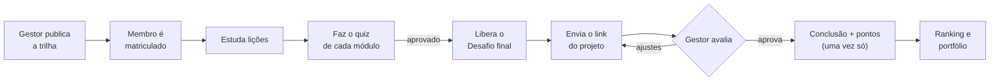
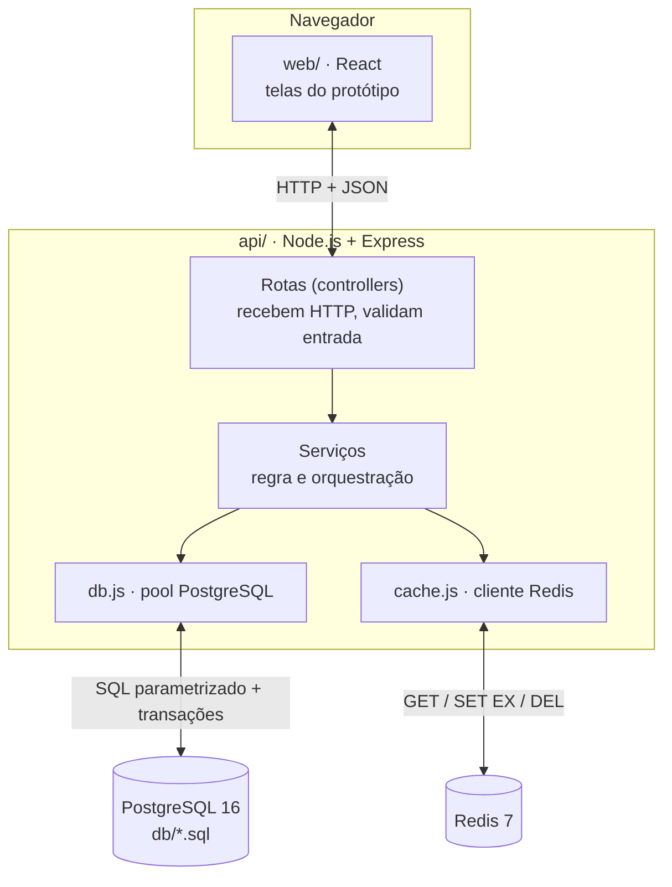

# Capítulo 0 · Visão geral, persistência poliglota e arquitetura

> **Objetivo do capítulo:** entender o EJ Quest de ponta a ponta antes de escrever uma linha.
> Ao terminar, você consegue desenhar a arquitetura num quadro e explicar por que existem dois
> bancos.
>
> **Tempo de leitura:** ~25 min · **Pré-requisito:** nenhum

---

## 0.1 O que estamos construindo, em uma frase

> Uma plataforma em que a EJ transforma conhecimento em **trilhas**, o membro **prova** o que
> aprendeu e a gestão **vê** quem já consegue fazer o quê, com pontos e ranking como incentivo.

🎯 Visão completa em `docs/spec/01-visao.md`. Protótipo no Figma, arquivo "EJ Quest".

### A história que o sistema conta



Guarde o passo **H**. Ele é o coração técnico do projeto em BD2: é onde aparecem transação,
concorrência, trigger, procedure e invalidação de cache.

✍️ **Minhas notas (0.1)**
>
>

---

## 0.2 Por que dois bancos? (persistência poliglota)

🧠 **Persistência poliglota** é usar mais de um tipo de banco no mesmo sistema, cada um para o
que faz melhor, em vez de forçar tudo num só.

| | PostgreSQL (relacional) | Redis (chave-valor, NoSQL) |
|---|---|---|
| Como guarda | Tabelas com linhas e colunas, ligadas por chaves | Pares `chave → valor` na memória |
| Ponto forte | Integridade, transações ACID, consultas complexas | Leitura e escrita muito rápidas, expiração automática |
| Ponto fraco | Recalcular agregações pesadas toda hora custa | Não garante relações nem regras; pode perder dados se cair |
| Papel no EJ Quest | **Fonte oficial** de tudo | **Cópia descartável** do ranking |

**Analogia:** o PostgreSQL é o **livro-caixa** da EJ: tudo registrado, conferido e assinado. O
Redis é o **quadro branco** na parede da sede, com o ranking da semana. Se alguém apagar o quadro, você refaz olhando o livro-caixa. O contrário nunca acontece.

🔧 **No EJ Quest:** toda leitura do ranking primeiro olha o quadro (Redis). Se estiver vazio ou
velho demais (mais de 60 s), consulta o livro (PostgreSQL), copia para o quadro e responde.

🎯 Cobre: **especificação de BD2** ("combinação relacional + não relacional, dividindo
responsabilidades de forma justificável"), **RF11**, **RNF06**, constituição item 2.

### Por que não usar só o PostgreSQL?

Daria. E isso é importante falar com honestidade: **100 mil registros não deixam o PostgreSQL
lento por si só.** O Redis entra porque o ranking é uma **agregação lida muitas vezes e mudada
poucas** (só quando alguém é aprovado). Guardar a resposta pronta evita refazer a soma a cada
abertura da tela. Se o ganho medido for pequeno, a apresentação diz que foi pequeno (constituição, item 8).

### Por que Redis e não MongoDB?

O dado que vai para o NoSQL é **um valor pronto, descartável e com prazo de validade**. Isso é
exatamente o caso de uso de chave-valor com TTL (Time To Live). MongoDB brilha com documentos flexíveis (um prontuário com exames diferentes, por exemplo), que o EJ Quest não tem no MVP. Usar Mongo só para "ter um banco de documentos" seria escolha por convenção, não por necessidade.

♻️ **Em outros projetos:** pergunte "este dado precisa de integridade e histórico, ou só precisa
ser lido rápido e pode ser refeito?". Primeiro caso: relacional. Segundo: cache chave-valor.
Sessões de login, carrinhos temporários, contadores e rankings são candidatos clássicos a Redis.

❓ **O professor pode perguntar:**
- "Se o Redis cair, o sistema para?" → Não. A API tem timeout curto e lê do PostgreSQL (RNF06).
- "O ranking pode mostrar valor errado?" → Pode mostrar valor **atrasado** em até ~60 s, nunca
  inventado. Por isso a tela mostra "Atualizado há X s".
- "Por que não Sorted Set?" → Ver DEC-005: foi considerado; o desempate da RN12 e a regra de o Redis nunca ser fonte pesaram a favor da string JSON.

✍️ **Minhas notas (0.2)**
>**ACID**
>**Atomicidade**: ou ocorre por completo ou nada. Qualquer falha volta o processo todo (rollback).
>**Consistência**: assegura que as transações levem o banco de um estado válido para outro estado válido, respeitando todas as regras, restrições (constraints) e integridades definidas.
>**Isolamento**: garante que transações simultâneas ocorram de forma independente, sem haver interferência ou enxergar dados intermediários.
>**Durabilidade**: garante que, uma vez que a transação seja confirmada (commit), as alterações fiquem salvas permanentemente, mesmo se houver falha.
>**O SQL (Structured Query Language)**: é uma linguagem de programação padronizada usada para gerenciar, consultar e manipular dados em bancos de dados relacionais
>**NoSQL ("Not Only SQL" ou não relacional):** é um sistema de gerenciamento de dados projetado para armazenar e consultar informações fora do modelo tradicional de tabelas, linhas e colunas. Principais Características: Esquema flexível, Escalabilidade horizontal, Alto desempenho.  Chave-Valor: Guarda os dados em pares simples de uma chave e um valor, excelente para cache. Exemplo: Redis 3. 

---

## 0.3 A arquitetura em camadas



🧠 **Arquitetura em camadas (MVC / Layered):** cada camada só conversa com a vizinha. A especificação de BD2 recomenda essa arquitetura (seção 3.1) por ser simples de construir e de depurar.

| Camada         | Pasta                       | Responsabilidade                                                 | Não pode                           |
| -------------- | --------------------------- | ---------------------------------------------------------------- | ---------------------------------- |
| Apresentação   | `web/`                      | Mostrar dados, coletar ações                                     | Falar com banco; decidir permissão |
| Rotas          | `api/src/rotas.js`          | Traduzir HTTP para chamada de serviço                            | Ter regra de negócio               |
| Serviços       | `api/src/servicos/`         | Regra, transação, decidir cache ou banco                         | Montar resposta HTML               |
| Acesso a dados | `api/src/db.js`, `cache.js` | Conexões                                                         | Saber de regra                     |
| Banco          | `db/`                       | Guardar e **defender** os dados (restrições, trigger, procedure) | Confiar que a API está certa       |

🔧 **Repare na última linha:** o banco não confia na API. Mesmo que a API tenha um bug e tente dar
ponto duas vezes, a chave primária de `pontuacao` recusa. Isso é **defesa em profundidade**.

🎯 Cobre: especificação de BD2 seção 3.1 (MVC/Layered), "API RESTful que orquestre os dois
bancos", constituição itens 1, 3 e 4. Decisões DEC-002 e DEC-003.

♻️ **Em outros projetos:** a pergunta "onde mora esta regra?" resolve metade dos bugs. Regra que
protege dado (unicidade, existência, valor válido) → banco. Regra de fluxo (quem pode, em que
ordem) → serviço. Formatação → tela.

❓ **O professor pode perguntar:**
- "Por que não microsserviços?" → Um desenvolvedor, um mês, um domínio. Microsserviços
  multiplicariam deploy, rede e consistência sem necessidade demonstrada. A especificação também recomenda MVC ou Microkernel para o tempo do semestre.
- "Por que sem ORM?" → DEC-003: um ORM esconderia as transações e bloqueios que são justamente o que esta disciplina avalia.

✍️ **Minhas notas (0.3)**
> **TTL (Time to Live)**: é um mecanismo usado em redes de computadores, DNS e CDNs para limitar a duração ou o alcance de dados.
> **MVC (Model-View-Controller)**:  um padrão arquitetural de software clássico utilizado para desenvolver a estrutura e a interface de aplicações (como sites, sistemas web e aplicativos). Divide o sistema em três partes: **Model (Modelo)**, Gerencia os **dados** e as regras de negócio; **View (Visão),** É a **interface gráfica** que o usuário vê e com a qual interage; **Controller (Controlador),** É a **ponte** que recebe os comandos do usuário na View, conversa com o Model para processar os dados e devolve a resposta para a View.
> **MCP (Model Context Protocol)**:  um protocolo aberto (criado pela Anthropic em novembro de 2024) que padroniza como assistentes de IA e Modelos de Linguagem (LLMs) se conectam a fontes de dados externas e ferramentas
>**API REST (ou API RESTful)**: é uma interface que permite a comunicação entre diferentes sistemas (como um aplicativo móvel e um servidor) utilizando os princípios do estilo arquitetural REST (Representational State Transfer)
>**Arquitetura de microsserviços**: uma aplicação é dividida em pequenos serviços independentes, focados em funções únicas e que se comunicam entre si por meio de APIs leves ou mensageria.
>**ORM (Object-Relational Mapping)**: cria uma "ponte" entre o modelo orientado a objetos do seu código e o modelo relacional de um banco de dados.

---

## 0.4 O mapa do repositório

```
ej-quest/
├── AGENTS.md, CLAUDE.md     regras para quem (ou o que) mexe no código
├── docker-compose.yml       sobe PostgreSQL, Redis e API
├── .env.example             variáveis (copiar para .env)
├── db/                      SQL: tabelas, índices, views, regras, povoamento
├── api/                     back-end Express
├── web/                     front React (veio da AB1 de PW1)
├── scripts/                 recriar-banco.sh
└── docs/
    ├── spec/                a lei: requisitos, arquitetura, plano, decisões  (SDD do agente)
    ├── manual/              este curso                                        (suas specs)
    └── resultados/          números medidos (sexta)
```

**Spec x manual, de novo, porque importa:** a spec diz **o que** e **por quê** de forma curta e
verificável. O manual ensina **como** e **o conceito por trás**. A spec é lida por mim antes de
codar; o manual é lido por você antes de cada sessão.

✍️ **Minhas notas (0.4)**
>
>

---

## 0.5 Do protótipo ao banco: rastreabilidade

Toda tela do Figma tem uma nota embaixo com requisito, endpoint e tabelas. Exemplo da tela mais importante para BD2:

| Tela | Requisitos | Endpoint | O que acontece no banco |
|---|---|---|---|
| 10 Avaliar entrega | RF08, RNF02, RNF03, RN09 | `POST /tentativas/:id/aprovar` | `BEGIN` → `CALL aprovar_projeto` (trava a participação) → insere resultado e conclusão → **trigger** insere pontuação → `COMMIT` → API apaga a chave do ranking no Redis |

O mapa completo está na página "Fluxos e notas" do Figma.

♻️ **Em outros projetos:** montar essa tabela **antes** de codar evita o retrabalho que você
mencionou: cada tela já nasce sabendo de que dado precisa e de onde ele vem.

✍️ **Minhas notas (0.5)**
>**Trigger (gatilho):** é um objeto de banco de dados associado a uma tabela que é executado automaticamente (BEFORE ou AFTER) em resposta a eventos de inserção, atualização ou exclusão de dados, servindo para impor regras de integridade ou automatizar rotinas.
>

---

## 0.6 Glossário do domínio

| Termo | Significa | Tabela |
|---|---|---|
| Diretoria | Unidade da EJ responsável por pessoas e trilhas | `diretoria` |
| Vínculo | Usuário numa diretoria, com papel `membro` ou `gestor` | `vinculo_diretoria` |
| Trilha | Sequência de módulos de uma diretoria | `trilha` |
| Módulo | Grupo ordenado de lições + 1 quiz | `modulo` |
| Lição | Texto e, opcionalmente, um link externo | `licao` |
| Avaliação | Quiz ou Desafio (projeto) | `avaliacao` |
| Matrícula | Usuário ↔ trilha (única) | `matricula` |
| Participação | Matrícula ↔ avaliação (única). **Alvo do bloqueio** | `participacao_avaliacao` |
| Tentativa | Um envio (quiz respondido ou link do desafio) | `tentativa_avaliacao` |
| Resultado | A decisão sobre uma tentativa | `resultado_tentativa` |
| Conclusão | O primeiro resultado aprovado de uma participação | `conclusao` |
| Pontuação | A recompensa ligada a uma conclusão | `pontuacao` |
| Ranking, progresso, portfólio | **Calculados**, não guardados | views e consultas |

✍️ **Minhas notas (0.6)**
>Analisar se os conteúdos foram definidos apenas por diretorias, sendo que para a EJ não terão somente os conteúdos por diretorias, terão os conteúdos gerais também. Isso são coisas a analisar após pronto e colocar como possível melhoria, mas pode analisar de agora para deixar a arquitetura pronta. 
>E sobre as avaliações, pensei em poder ter mais de uma tentativa futuramente, caso a pessoa queira revisar, ou seja, não barrar a tentativa e não dar pontuação por isso. Ainda a analisar e estruturar
>

---

## ✍️ Fechamento do capítulo 0

**O que aprendi:**
>Fui colocando na nota termos que eu não sabia ou pontos que analisei. Aprendi melhor como funciona a estrutura do projeto, as camadas, termos técnicos, tipos de banco de dados. Aprendizados específicos: ACID, SQL e NoSQL, TTL, MVC, MCP, API REST, arquitetura de microserviços, trigger

**O que ainda não está claro:**
>Um aprendizado mais profundo e focado nos termos técnicos de back-end e banco de dados, como trigger, chamadas para o banco, camadas, comunicação, implementação prática

**Dificuldades:**
>Os termos técnicos e a parte do back-end, banco de dados e api. Eu tenho mais facilidade com o front porque vi muito na EJ, mas ainda não tenho um conhecimento vasto, mas é mais do que os outros que citei no começo dessa frase.

**Insights (inclusive para outros projetos):**
>Sempre fazer um bom mapeamento e incluir dentro do protótipo a descrição do fluxo e o requisito que cada tela atende, como foi feito nesse figma. Fica mais fácil de analisar os requisitos e saber quais estão sendo cumpridos e como e onde.
