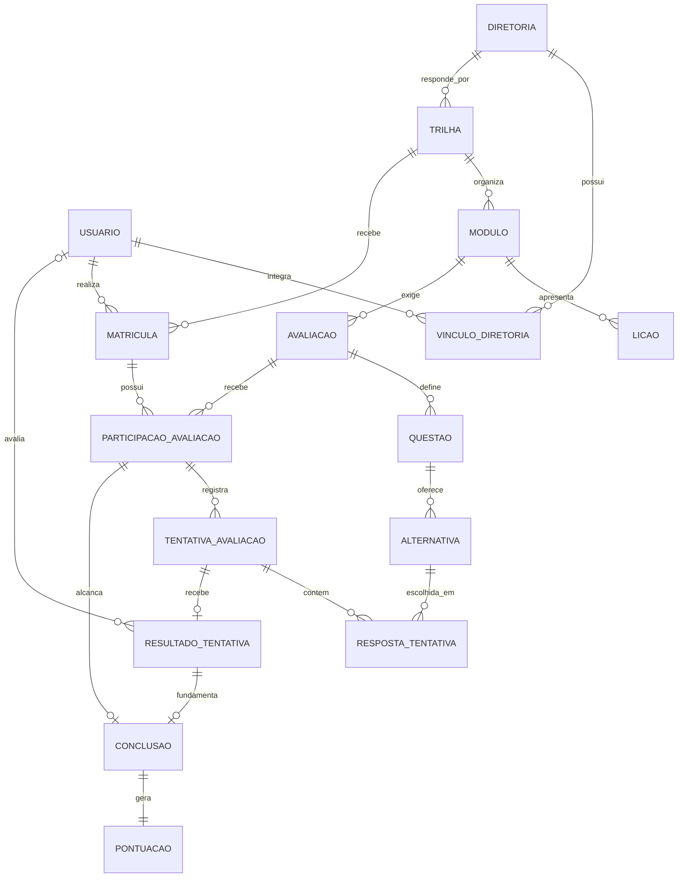
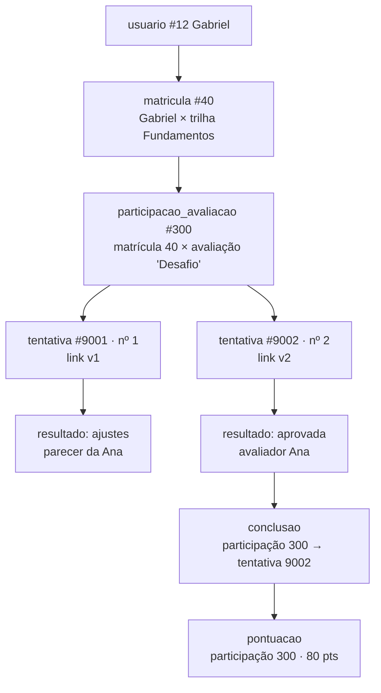

# Capítulo 1 · Ambiente com Docker e modelagem relacional

> **Objetivo do capítulo:** (1) entender o que o `docker compose up` faz e por que o ambiente é
> reproduzível; (2) entender o modelo de dados do EJ Quest a ponto de explicar cada tabela, cada
> chave e por que ele está na 3FN. É a base do que escrevemos na quarta (capítulo 2).
>
> **Tempo de leitura:** ~40 min · **Pré-requisito:** capítulo 0

---

# Parte A · O ambiente

## 1.1 Docker em quatro palavras

| 🧠 Conceito | O que é | Analogia |
|---|---|---|
| **Imagem** | Um molde pronto e imutável de um programa (ex.: `postgres:16`) | A planta da casa |
| **Contêiner** | Uma imagem rodando, isolada do resto da máquina | A casa construída |
| **Volume** | Uma pasta que sobrevive quando o contêiner é apagado | O cofre da casa: derruba a casa, o cofre fica |
| **Rede** | Os contêineres do mesmo Compose se enxergam pelo nome do serviço | O interfone do condomínio |

🔧 **No EJ Quest:** a API acessa o banco em `db:5432` e o Redis em `cache:6379`. `db` e `cache`
são **nomes de serviço**, resolvidos pela rede interna do Compose. Da sua máquina, você acessa
pelas portas publicadas `5433` e `6380`.

## 1.2 O `docker-compose.yml`, peça por peça

```yaml
services:
  db:                                   # serviço 1: PostgreSQL
    image: postgres:16
    ports: ["5433:5432"]                # sua máquina:contêiner
    volumes:
      - dados_postgres:/var/lib/postgresql/data   # dados persistem
      - ./db:/db:ro                     # seus .sql visíveis dentro do contêiner
    healthcheck: pg_isready ...         # "o banco já aceita conexão?"
  cache:                                # serviço 2: Redis
    image: redis:7
    command: redis-server --save "" --appendonly no   # sem disco, de propósito
  api:                                  # serviço 3: nossa API
    build: ./api                        # construída do Dockerfile
    depends_on:
      db:    { condition: service_healthy }   # espera o banco ficar pronto
      cache: { condition: service_started }   # o Redis NÃO é condição de vida
```

**Três escolhas que você deve saber justificar:**

1. **Porta 5433, não 5432.** O Plano Diretor também usa PostgreSQL local. Mapear para outra porta
   evita conflito entre os dois projetos.
2. **Redis sem persistência.** O ranking no Redis é descartável por definição (constituição, item
   2). Salvar em disco seria pagar custo para guardar algo que podemos refazer.
3. **`depends_on` com `service_healthy` só para o banco.** A API não sobe antes de o PostgreSQL
   aceitar conexões. Mas ela **sobe mesmo com o Redis fora**, porque o sistema precisa funcionar
   sem cache (RNF06).

🎯 Cobre: entregável 2 da especificação de BD2 ("Docker Compose para subir todo o ambiente"),
**RNF10** (reprodutibilidade), **RNF11** (custo zero).

## 1.3 Comandos do dia a dia

| Quero... | Comando |
|---|---|
| Subir tudo | `docker compose up -d --build` |
| Ver o que está de pé | `docker compose ps` |
| Ver os logs da API | `docker compose logs -f api` |
| Abrir o SQL interativo | `docker compose exec db psql -U ej_quest -d ej_quest` |
| Abrir o Redis interativo | `docker compose exec cache redis-cli` |
| Recriar o banco do zero | `./scripts/recriar-banco.sh` (ou `... sem-povoamento`) |
| Derrubar só o Redis (teste) | `docker compose stop cache` |
| Desligar tudo (dados ficam) | `docker compose down` |
| Desligar e **apagar o banco** | `docker compose down -v` |

Atalhos úteis dentro do `psql`: `\dt` (tabelas), `\d nome` (estrutura e restrições), `\di`
(índices), `\dv` (views), `\df` (funções e procedures), `\q` (sair).

⚠️ **Lição que você já aprendeu no Plano Diretor:** o volume guarda a senha com que o banco foi
criado. Trocar a senha no `.env` depois não muda o banco existente. Ver o aprendizado
"volume-postgres-guarda-a-senha-antiga" no seu segundo cérebro.

♻️ **Em outros projetos:** o trio "banco com volume + cache sem volume + app com `depends_on`
saudável" serve para quase todo back-end. Copie o Compose e troque imagens e nomes.

❓ **O professor pode perguntar:**
- "Como eu rodo na minha máquina?" → `cp .env.example .env`, `docker compose up -d --build`,
  `./scripts/recriar-banco.sh`. Está no README.
- "Volume é backup?" → Não. Volume sobrevive ao contêiner, mas não a um disco perdido ou a um
  `down -v`. Backup é cópia em outro lugar.

✍️ **Minhas notas (Parte A)**
>
>

---

# Parte B · A modelagem

## 1.4 Do problema às entidades

O caminho foi: listar os **substantivos** do domínio (usuário, trilha, módulo, lição, quiz,
projeto, entrega, parecer, ponto) e perguntar, para cada um, "isso tem vida própria e várias
ocorrências?". Se sim, vira tabela. Depois, para cada par, "quantos de um para quantos do outro?".

### O diagrama ER



**Como ler as pontas:** `||` exatamente um · `o|` zero ou um · `o{` zero ou muitos.
Exemplo: `MATRICULA ||--o{ PARTICIPACAO_AVALIACAO` = uma matrícula tem zero ou muitas
participações; cada participação pertence a exatamente uma matrícula.

O ER completo, com todos os atributos, está no planejamento da AB1 (seção 5.3) e vira código no
capítulo 2.

### As 16 tabelas em quatro grupos

| Grupo | Tabelas | Para quê |
|---|---|---|
| **Acesso** | `usuario`, `diretoria`, `vinculo_diretoria` | Quem é quem e quem gere o quê |
| **Conteúdo** | `trilha`, `modulo`, `licao`, `avaliacao`, `questao`, `alternativa` | O que se estuda e como se avalia |
| **Participação** | `matricula`, `participacao_avaliacao`, `tentativa_avaliacao`, `resposta_tentativa`, `resultado_tentativa` | O que o membro fez e o que foi decidido |
| **Recompensa** | `conclusao`, `pontuacao` | O que conta para progresso e ranking |

## 1.5 A história de uma aprovação, tabela por tabela

Siga o Gabriel entregando o Desafio "Landing page da EJ":



**Por que existe `participacao_avaliacao`?** Ela parece "mais uma tabela", mas é a peça-chave:

1. **Agrupa as tentativas** de um mesmo membro numa mesma avaliação (tentativa 1, 2, 3...).
2. **Garante unicidade** (RN04): um par matrícula × avaliação só existe uma vez.
3. **É o alvo do bloqueio** (DEC-008): na aprovação, a procedure trava **esta linha**. Assim, duas
   aprovações simultâneas de tentativas diferentes da mesma participação não geram duas
   conclusões. Se travássemos só a tentativa, a tentativa 1 e a 2 poderiam ser aprovadas em
   paralelo.
4. **É a chave da conclusão e da pontuação:** `conclusao` e `pontuacao` usam `id_participacao`
   como chave primária. Chave primária não repete, então **é impossível existir duas conclusões
   ou duas pontuações para a mesma participação**, mesmo com bug na API.

🎯 Cobre: **RN04**, **RN07**, **RN09**, **RNF01**, **RNF03**, **RNF07**.

## 1.6 Normalização: 1FN, 2FN e 3FN com exemplos do projeto

🧠 **Normalizar** é organizar as tabelas para que **cada fato fique guardado num lugar só**. É a
mesma regra do "dono único" do seu segundo cérebro: fato copiado em dois lugares envelhece em
ritmos diferentes e um dia os dois discordam.

### 1FN · cada célula guarda um valor só

❌ **Errado:** `tentativa_avaliacao (id, respostas)` com `respostas = '2,4,1,3'`.
Como achar todo mundo que errou a questão 2? Precisaria cortar texto.

✅ **No EJ Quest:** cada resposta é uma linha em `resposta_tentativa (id_tentativa, id_questao,
numero_alternativa)`.

### 2FN · em chave composta, nada depende de só um pedaço da chave

❌ **Errado:** `vinculo_diretoria (id_usuario, id_diretoria, papel, nome_diretoria)`.
`nome_diretoria` depende só de `id_diretoria`, não do par. Renomear a diretoria obrigaria a
atualizar todas as linhas de vínculo.

✅ **No EJ Quest:** `papel` depende do par (você pode ser gestor em Projetos e membro em
Marketing). O nome fica em `diretoria`. O mesmo vale para `resposta_tentativa`: a alternativa
escolhida depende de tentativa **e** questão; o enunciado depende só da questão, então mora em
`questao`.

### 3FN · nada depende de outra coluna que não é chave (sem dependência transitiva)

❌ **Errado:** `tentativa_avaliacao (id_tentativa, id_participacao, id_usuario, ...)`.
O usuário já é alcançado por `tentativa → participação → matrícula → usuário`. Guardar
`id_usuario` também permite o absurdo de uma tentativa dizer "usuário 12" enquanto a matrícula dela
diz "usuário 15".

✅ **No EJ Quest:** `tentativa_avaliacao` **não tem** `id_usuario`; `pontuacao` **não tem**
`id_usuario`. Total de pontos, percentual de progresso e portfólio também não são guardados: são
**calculados** (views e consultas).

**O preço da 3FN:** consultas com mais JOINs. O ranking precisa andar
`pontuacao → participacao_avaliacao → matricula → usuario`. É exatamente aí que entram a **view**
(organiza a consulta), o **índice** (acelera os JOINs) e o **cache** (evita repetir a soma). Ou
seja: a normalização cria o problema que o resto da disciplina resolve. Essa é uma ótima frase
para a apresentação.

**Dois "fatos históricos" que parecem duplicação e não são:** `pontuacao.pontos` e
`resultado_tentativa.percentual_acerto`. Eles registram **o que valia no momento do evento**. Se a
avaliação mudar de 80 para 100 pontos numa nova edição, quem foi aprovado antes continua com 80.

🎯 Cobre: especificação de BD2 ("modelagem normalizada até 3FN"), **RNF01**, **RNF07**.

❓ **O professor pode perguntar:**
- "Mostre uma dependência transitiva que você evitou." → `id_usuario` na tentativa (acima).
- "Ter FK garante 3FN?" → Não. FK garante que a referência existe. 3FN é sobre de que cada coluna
  depende. São coisas diferentes.
- "Por que `alternativa` tem chave composta?" → A alternativa só existe dentro da questão
  ("alternativa 2 da questão 57"). Com `(id_questao, numero)`, a resposta aponta para uma escolha
  válida daquela questão sem guardar um id global e a questão de forma redundante.

## 1.7 Restrições: o banco se defendendo

| 🧠 Restrição | O que impede | Exemplo no EJ Quest | Requisito |
|---|---|---|---|
| `PRIMARY KEY` | Linha sem identidade ou repetida | `conclusao (id_participacao)` → uma conclusão por participação | RN09 |
| `FOREIGN KEY` | Referência para algo que não existe (órfão) | `matricula.id_trilha` precisa existir em `trilha` | RNF01 |
| `UNIQUE` | Duplicidade de um valor ou combinação | `matricula (id_usuario, id_trilha)` | RN04 |
| `CHECK` | Valor fora da regra | `avaliacao.tipo IN ('quiz','projeto')`, `pontos_previstos > 0` | RN10 |
| `NOT NULL` | Campo obrigatório vazio | `tentativa_avaliacao.enviada_em` | RNF07 |
| `DEFAULT` | Esquecer um valor padrão | `enviada_em DEFAULT now()` | - |
| Índice único em expressão | Duplicata disfarçada | `UNIQUE (lower(email))` → `A@x.com` e `a@x.com` não convivem | RN01 |

### `ON DELETE`: o que acontece com os filhos quando o pai é apagado

| Opção | Efeito | Uso no EJ Quest |
|---|---|---|
| `RESTRICT` / `NO ACTION` | Recusa apagar o pai se houver filhos | **Padrão do projeto.** Histórico não se apaga (RN17, constituição 6) |
| `CASCADE` | Apaga os filhos junto | Evitar: um `DELETE` em `usuario` levaria tentativas e pontos |
| `SET NULL` | Deixa o filho sem pai | Não usado |

Por isso **desligar** um membro é `UPDATE usuario SET ativo = false`, nunca `DELETE`.

### Chave substituta x chave natural

- **Substituta** (`id_usuario bigint GENERATED ALWAYS AS IDENTITY`): número sem significado,
  gerado pelo banco. Nunca muda.
- **Natural** (o e-mail): tem significado, mas pode mudar.

O projeto usa substituta como PK e protege a natural com `UNIQUE`. Assim, trocar o e-mail de
alguém não quebra nenhuma FK.

♻️ **Em outros projetos:** para cada tabela, responda por escrito antes de criar: (1) qual a
chave? (2) quem eu referencio? (3) o que não pode repetir? (4) que valor é proibido? (5) o que
acontece se o pai for apagado? As respostas viram as restrições.

## 1.8 Exercício (5 minutos, antes da sessão de quarta)

Para cada comando, diga se o banco aceita ou recusa, e qual restrição age. Respostas no fim.

1. Inserir uma matrícula do usuário 12 na trilha 3, e depois outra igual.
2. Inserir uma tentativa para a participação 99999, que não existe.
3. Inserir uma avaliação com `tipo = 'prova'`.
4. Inserir a segunda linha em `pontuacao` para a participação 300.
5. Apagar o usuário 12, que tem matrículas.
6. Cadastrar `Gabriel@Rocket.com` quando já existe `gabriel@rocket.com`.

<details>
<summary>Respostas</summary>

1. A segunda é recusada: `UNIQUE (id_usuario, id_trilha)` (RN04).
2. Recusada: FK `id_participacao` (RNF01).
3. Recusada: `CHECK (tipo IN ('quiz','projeto'))`.
4. Recusada: PK `pontuacao (id_participacao)` (RN09).
5. Recusado: FK com `ON DELETE RESTRICT` (RN17). O certo é desligar.
6. Recusado: índice único em `lower(email)` (RN01).

</details>

## 1.9 Como ficou no projeto

*Esta seção é preenchida depois da sessão de quarta (DDL em par), com o código real e o que mudou
em relação ao planejamento.*

## 1.10 O que o professor pode perguntar (resumo do capítulo)

- Por que dois bancos e qual o papel de cada?
- Como você chegou nas tabelas? Por que existe `participacao_avaliacao`?
- Mostre 1FN, 2FN e 3FN no seu modelo.
- O que impede ponto duplicado, antes mesmo da procedure?
- Por que não há `DELETE` de usuário?
- Como subo o ambiente? Volume é backup?

---

## ✍️ Fechamento do capítulo 1

**O que aprendi:**
>

**O que ainda não está claro:**
>

**Dificuldades:**
>

**Insights (inclusive para outros projetos):**
>
