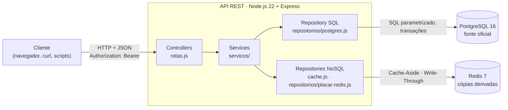
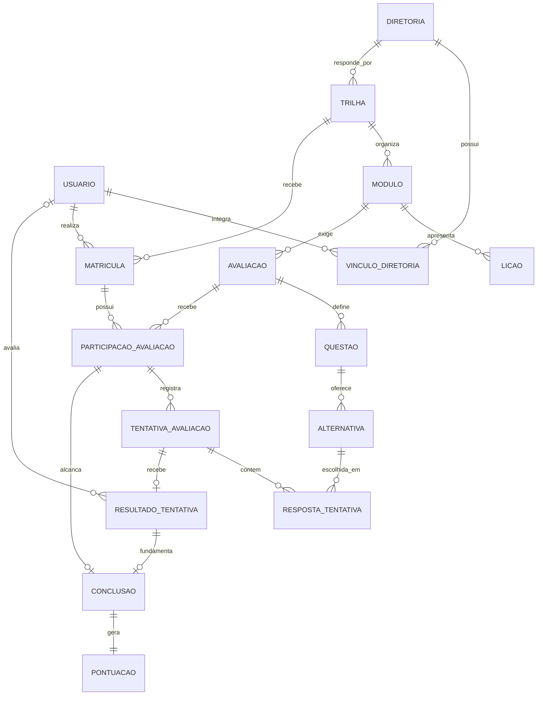
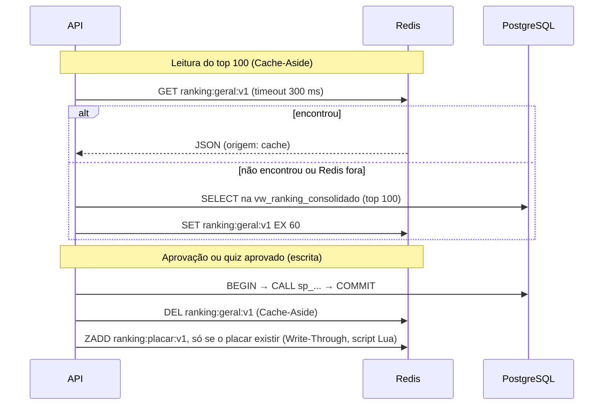

# EJ Quest · Relatório do Projeto Prático (AB2)

**Universidade Federal de Alagoas · Campus Arapiraca · Unidade Educacional Penedo**

**Bacharelado em Sistemas de Informação · 6º período · Banco de Dados II (SISB107)**

| Item | Informação |
|---|---|
| **Projeto** | EJ Quest: plataforma de gestão do conhecimento gamificada para Empresas Juniores |
| **Autor** | José Gabriel Fideles Silva (desenvolvimento individual, como declarado na AB1) |
| **Entrega** | AB2 · 13/11/2026 |
| **Repositório** | https://github.com/josefideles/ej-quest |
| **Base desta entrega** | Documento Final de Planejamento da AB1 (versão 1.0, 18/09/2026) e Especificação de Projeto de BD II |

---

## Sumário

1. Resumo
2. O problema e a solução
3. O que foi prometido na AB1 e o que foi entregue
4. Atendimento à especificação de Banco de Dados II
5. Arquitetura
6. Modelo relacional (PostgreSQL)
7. Objetos programáveis: views, procedures e triggers
8. Transações e controle de concorrência
9. Modelo não relacional (Redis) e sincronização
10. API REST e autenticação
11. Carga de dados
12. Experimentos e resultados
13. Testes e evidências
14. Como rodar o projeto (passo a passo)
15. Papel do integrante, autoria e uso de IA
16. Limitações e próximos passos
17. Referências

---

## 1. Resumo

O EJ Quest organiza o conhecimento de uma Empresa Júnior em trilhas de capacitação. Cada trilha
tem módulos com lições e um quiz; o último módulo tem um desafio prático, enviado por link e
avaliado pelo gestor da diretoria. Cada quiz ou desafio aprovado gera pontos uma única vez, e os
pontos alimentam um ranking.

A persistência é poliglota. O **PostgreSQL 16** é a fonte oficial: 16 tabelas na terceira forma
normal, com restrições de integridade, 3 views, 4 procedures, 4 triggers e um índice escolhido por
medição. O **Redis 7** guarda apenas cópias derivadas do ranking, com dois padrões de sincronização:
**Cache-Aside** no top 100 e **Write-Through** num placar em **Sorted Set**. Uma **API REST em
Node.js e Express** é o único componente que acessa os dois bancos. O ambiente sobe com
**Docker Compose**, e a carga de **140.574 tentativas** é criada automaticamente na primeira subida.

Principais resultados medidos (seção 12): o índice leva a consulta das entregas recentes de
53,0 ms para 0,26 ms; o Redis eleva a vazão do ranking de 159 para 898 requisições por segundo e a
da posição do usuário de 148 para 1.304 requisições por segundo. Os testes comprovam que duas
aprovações simultâneas da mesma entrega geram uma única conclusão e uma única pontuação, e que uma
falha antes do COMMIT não deixa nada gravado pela metade.

## 2. O problema e a solução

Em uma Empresa Júnior, parte do conhecimento institucional fica concentrada em quem já passou pela
gestão, e outra parte fica dispersa em pastas sem ordem de estudo. A cada troca de gestão, o novo
membro tem dificuldade de saber o que estudar e o gestor repete as mesmas explicações (AB1, seção 1.1).

A solução proposta na AB1 e implementada nesta entrega:

| Ator | O que faz na plataforma |
|---|---|
| Membro | Entra com e-mail e senha, estuda as lições da trilha, responde os quizzes, envia o desafio final por link, acompanha o progresso, o portfólio e a posição no ranking |
| Gestor de diretoria | Vê a fila de entregas da sua diretoria, aprova ou pede ajustes com parecer |
| Gestor geral | Avalia entregas de todas as diretorias |

## 3. O que foi prometido na AB1 e o que foi entregue

A AB1 definiu que a AB2 estaria pronta quando "o fluxo de estudo, submissão, avaliação e consulta
funcionar; permissões estiverem verificadas; duplicidade e gravação parcial estiverem impedidas; o
ranking operar com e sem Redis; os 100 mil registros puderem ser gerados; os experimentos tiverem
resultados registrados; e o repositório permitir reprodução do ambiente" (AB1, seção 5.9).

### 3.1 Definição de pronto da AB1

| Critério da AB1 | Situação | Onde verificar |
|---|---|---|
| Fluxo de estudo (lições e quiz) | **Entregue na API** | `GET /trilhas/:id`, `GET /avaliacoes/:id`, `POST /avaliacoes/:id/respostas` |
| Submissão e avaliação do desafio | **Entregue** | `POST /avaliacoes/:id/tentativas`, `POST /tentativas/:id/aprovar` e `/ajustes` |
| Consulta (progresso, portfólio, ranking) | **Entregue** | `GET /matriculas/:id/progresso`, `/eu/portfolio`, `/ranking`, `/ranking/eu` |
| Permissões verificadas | **Entregue** | Login com senha, escopo do gestor, autoaprovação recusada (seção 13) |
| Duplicidade e gravação parcial impedidas | **Entregue** | Testes de concorrência e de atomicidade (seção 8) |
| Ranking com e sem Redis | **Entregue** | Teste "Queda do Redis" (seção 13) |
| 100 mil registros gerados | **Entregue** | 140.574 tentativas (seção 11) |
| Experimentos registrados | **Entregue** | `docs/resultados/` (seção 12) |
| Ambiente reproduzível | **Entregue** | Um comando: `docker compose up -d --build` (seção 14) |

### 3.2 Requisitos funcionais da AB1

| RF | Requisito | Situação na AB2 |
|---|---|---|
| RF01 | Autenticar e encerrar sessão | Entregue: senha bcrypt conferida no banco, token assinado, desligado não entra |
| RF02 | Administrar usuários, vínculos e permissões | **Não entregue pela API.** Usuários, vínculos e permissões existem no banco (carga), sem telas ou rotas de cadastro |
| RF03 | Cadastrar, publicar e arquivar trilhas | **Não entregue pela API.** Trilhas, módulos, lições e avaliações existem no banco (carga) |
| RF04 | Matricular membros | Parcial: unicidade garantida no banco (`UNIQUE`); matrículas criadas pela carga, sem rota |
| RF05 | Exibir conteúdo | Entregue na API |
| RF06 | Quiz corrigido no servidor | Entregue: `sp_responder_quiz` corrige dentro do banco; o gabarito nunca sai do servidor |
| RF07 | Receber projeto por link | Entregue |
| RF08 | Avaliar projeto e registrar parecer | Entregue |
| RF09 | Progresso e pendências | Entregue |
| RF10 | Portfólio interno | Entregue na API |
| RF11 | Pontos e ranking | Entregue, com cache e placar reconstruíveis |
| RF12 | Histórico e acompanhamento | Entregue no banco (`ativo`, `ON DELETE RESTRICT`, imutabilidade) e na fila do gestor |

**Interface (React):** a AB1 previa telas React. Elas são o escopo da disciplina de Programação Web
I (AB2 de PW1 em 18/11 e 25/11/2026). Nesta entrega de BD II, o sistema é demonstrado pela API, pelos
scripts e pelo `psql`, que é o que a especificação de BD II avalia ("tela visualmente concluída,
isoladamente, não atende ao critério de entrega", AB1, seção 5.9). O protótipo das telas existe no
Figma, e o front está em desenvolvimento na pasta `web/`.

### 3.3 Mudanças em relação à AB1, e por quê

| O que mudou | Por quê | Registro |
|---|---|---|
| O índice do experimento passou a ser `idx_tentativa_enviada_em` | A AB1 pedia para "comparar com o índice já existente de número por participação". Medido: o índice planejado não trouxe ganho (0,25 ms sem, 0,28 ms com), porque a `UNIQUE (id_participacao, numero)` já cobre a consulta | DEC-010 |
| Além do Cache-Aside previsto, o placar em Sorted Set com Write-Through | A especificação de BD II sugere Sorted Sets para placares de gamificação. A posição de um usuário qualquer custava numerar o ranking inteiro no SQL | DEC-012 |
| Procedures com prefixo `sp_` e imutabilidade do histórico por trigger | Boas práticas da aula 5 (prefixos `vw_`, `sp_`, `trg_`); a RN18 passou a ser garantida no banco | DEC-011 |
| Camada de repositórios explícita | Prevista na AB1 (seção 3.1) e na seção 3.1 da especificação | DEC-013 |
| Login com `pgcrypto` e token assinado | Cumprir RF01 sem dependências novas e sem tornar o Redis obrigatório para entrar | DEC-014 |

Todas as decisões estão em `docs/spec/decisoes/` (DEC-001 a DEC-014), cada uma com contexto,
alternativas e consequências.

## 4. Atendimento à especificação de Banco de Dados II

| Exigência da especificação | Como o projeto atende | Seção |
|---|---|---|
| SGBD relacional + NoSQL com divisão justificável | PostgreSQL 16 (fonte oficial) + Redis 7 (cópias derivadas) | 5, 9 |
| Modelagem normalizada até a 3FN | 16 tabelas, normalização demonstrada | 6 |
| Transações ACID | Aprovação, ajustes, envio e quiz em transação; atomicidade testada | 8 |
| Restrições de integridade | 16 PK, 21 FK, 9 UNIQUE, 22 CHECK, índices únicos em expressão e parcial | 6 |
| Índices bem planejados | Índice escolhido por medição, com plano de execução | 12 |
| Visões | `vw_ranking_consolidado`, `vw_progresso_membro`, `vw_fila_avaliacao` | 7 |
| Stored procedures e triggers para regras críticas | 4 procedures `sp_` e 4 triggers `trg_` | 7 |
| NoSQL com justificativa técnica | Cache de alta velocidade e placar de líderes | 9 |
| API RESTful que orquestra os dois bancos | Node.js 22 + Express, 15 rotas | 10 |
| Padrões de sincronização SQL/NoSQL | Cache-Aside e Write-Through | 9 |
| Scripts DDL/DML e rotinas NoSQL | `db/*.sql`, `api/src/repositorios/` | 6, 9 |
| Povoamento com ≥ 100.000 registros na entidade principal | 140.574 tentativas, reprodutível | 11 |
| Análise com e sem indexação e caching | Latência e vazão medidas | 12 |
| Documento de arquitetura e modelagem (ER, coleções, justificativa) | Seções 5, 6 e 9 deste relatório e `docs/arquitetura-e-modelagem.md` | 5, 6, 9 |
| Repositório com scripts, API e Docker Compose | Este repositório | 14 |
| Demonstração de carga, consistência e vazão | Scripts de teste e medição com saídas guardadas | 12, 13 |
| Arquitetura recomendada (MVC/Layered) | Controller, Service, Repository | 5 |

## 5. Arquitetura

Monólito em camadas, a primeira arquitetura recomendada pela especificação (seção 3.1), já prevista
na AB1.



| Camada | Responsabilidade | Não faz |
|---|---|---|
| Controller (`rotas.js`) | Traduz HTTP: valida parâmetros, chama o serviço, responde JSON | Regra de negócio |
| Service (`servicos/`) | Orquestra: transação, cache ou banco, sincronização com o Redis | SQL |
| Repository (`repositorios/`, `cache.js`) | Todo o SQL parametrizado e os comandos do Redis | Decidir regra |
| Banco | Guarda e **defende** os dados (restrições, procedures, triggers) | Confiar que a API está correta |

- **Sem ORM** (DEC-003): as transações, os bloqueios e as procedures, que são o objeto da disciplina,
  ficam explícitos no código.
- **Docker Compose** sobe três serviços: `db` (PostgreSQL), `cache` (Redis) e `api`.

## 6. Modelo relacional (PostgreSQL)

### 6.1 Diagrama entidade-relacionamento



O diagrama com todos os atributos está em `docs/arquitetura-e-modelagem.md`, seção 3.1, e o DDL
completo em `db/01_schema.sql`.

| Grupo | Tabelas | Para quê |
|---|---|---|
| Acesso | `usuario`, `diretoria`, `vinculo_diretoria` | Quem é quem e quem gere o quê |
| Conteúdo | `trilha`, `modulo`, `licao`, `avaliacao`, `questao`, `alternativa` | O que se estuda e como se avalia |
| Participação | `matricula`, `participacao_avaliacao`, `tentativa_avaliacao`, `resposta_tentativa`, `resultado_tentativa` | O que o membro fez e o que foi decidido |
| Recompensa | `conclusao`, `pontuacao` | O que conta para progresso e ranking |

**A tabela central é `participacao_avaliacao`** (o par matrícula × avaliação). Ela agrupa as
tentativas, garante unicidade (`UNIQUE (id_matricula, id_avaliacao)`, RN04), é a linha travada com
`FOR UPDATE` em toda operação de envio e parecer, e é a chave primária de `conclusao` e `pontuacao`.
Como chave primária não se repete, **é impossível existir duas conclusões ou duas pontuações para a
mesma participação**, mesmo com erro na aplicação.

### 6.2 Normalização

| Forma | Como o modelo atende |
|---|---|
| 1FN | Nenhum atributo multivalorado: cada resposta de quiz é uma linha de `resposta_tentativa` |
| 2FN | Em chaves compostas, os atributos dependem da chave inteira: `papel` depende do par usuário × diretoria; o nome da diretoria fica em `diretoria` |
| 3FN | Sem dependência transitiva: `tentativa_avaliacao` e `pontuacao` não guardam `id_usuario`, que é alcançado por participação → matrícula → usuário |

Totais de pontos, percentuais de progresso e posições no ranking **não são armazenados**: são
calculados por views. `pontuacao.pontos` e `resultado_tentativa.percentual_acerto` são fatos
históricos (o valor no momento do evento), não redundância.

### 6.3 Restrições de destaque

| Restrição | Regra que garante |
|---|---|
| `CREATE UNIQUE INDEX ... ON usuario (lower(email))` | RN01: e-mail único sem diferenciar maiúsculas |
| `CREATE UNIQUE INDEX ... ON alternativa (id_questao) WHERE correta` (índice parcial) | RN05: no máximo uma alternativa correta por questão |
| FK composta `conclusao (id_participacao, id_tentativa)` → `tentativa_avaliacao` | A tentativa que conclui a participação pertence a ela |
| FK composta `resposta_tentativa (id_questao, numero_alternativa)` → `alternativa` | A alternativa escolhida existe naquela questão |
| `CHECK` condicional em `avaliacao` | Quiz exige nota mínima; desafio não tem |
| `ON DELETE RESTRICT` em todas as FKs | RN17: desligar não apaga histórico (`ativo = false`) |

Um achado dos testes: a primeira versão do `CHECK` de nota mínima **aceitava** um quiz sem nota,
porque `CHECK` só recusa quando a expressão é falsa, e `NULL BETWEEN 0 AND 100` resulta em `NULL`.
A correção (`percentual_minimo IS NOT NULL AND ...`) e o teste que a comprova estão no repositório.

## 7. Objetos programáveis: views, procedures e triggers

Nomes seguem a convenção da aula 5 (`vw_`, `sp_`, `trg_`, `fn_`).

| Objeto | Tipo | Papel |
|---|---|---|
| `vw_ranking_consolidado` | View | Total de pontos e última concessão por usuário ativo. A ordem (RN12) fica na consulta que a usa |
| `vw_progresso_membro` | View | Avaliações exigidas × concluídas por matrícula (RN11) |
| `vw_fila_avaliacao` | View | Entregas de desafio sem parecer, com a diretoria, para o escopo do gestor |
| `sp_aprovar_projeto` | Procedure | Trava a participação, valida permissão, garante idempotência, grava resultado e conclusão |
| `sp_pedir_ajustes` | Procedure | Mesma trava e validação; parecer obrigatório |
| `sp_enviar_projeto` | Procedure | Aplica RN06 (quizzes antes), RN07 (nada após aprovado) e RN08 (um envio aguardando por vez) |
| `sp_responder_quiz` | Procedure | Valida as respostas, corrige no servidor e, se aprovado, gera a conclusão (RF06) |
| `trg_conclusao_pontua` | Trigger `AFTER INSERT` | Toda conclusão gera exatamente uma pontuação, na mesma transação |
| `trg_resultado_imutavel`, `trg_conclusao_imutavel`, `trg_pontuacao_imutavel` | Triggers `BEFORE UPDATE OR DELETE` | O histórico não pode ser alterado nem apagado (RN18) |
| `fn_autenticar`, `fn_pode_avaliar`, `fn_travar_tentativa`, `fn_validar_avaliador` | Funções | Login e regras auxiliares das procedures |

As procedures recebem os dados como parâmetros de entrada e devolvem o resultado em parâmetros
`INOUT` (por exemplo, `p_status`). Nenhuma faz `COMMIT`: quem abre e fecha a transação é a API, para
que procedure, trigger e o restante confirmem ou desfaçam juntos. Os erros de regra usam códigos
próprios (`EJ400`, `EJ403`, `EJ404`, `EJ409`), que a API traduz para os códigos HTTP equivalentes.

Trigger e constraint foram usadas conforme a regra da aula 5 ("se der para resolver com
constraint, prefira constraint"): unicidade, referência e valores proibidos são restrições
declarativas; triggers só onde a constraint não alcança (criar a pontuação junto com a conclusão e
proibir UPDATE e DELETE de fatos históricos).

## 8. Transações e controle de concorrência

| Propriedade | No EJ Quest | Evidência |
|---|---|---|
| Atomicidade | Resultado, conclusão e pontuação entram juntos ou nenhum entra | Teste: 1/1/1 dentro da transação → `ROLLBACK` → 0/0/0 |
| Consistência | 25 operações proibidas recusadas por restrições, triggers e procedures | `testes-banco.txt` |
| Isolamento | `SELECT ... FOR UPDATE` na participação serializa operações sobre ela | Teste com duas sessões |
| Durabilidade | O `COMMIT` só retorna depois do registro no WAL em disco | Volume persistente do PostgreSQL |

**Concorrência (RNF03).** Duas sessões aprovam a mesma entrega ao mesmo tempo. A sessão A trava a
participação e segura a transação por 3 s; a sessão B chega 1 s depois e **espera** no
`FOR UPDATE`. Quando A confirma, B destrava, relê o estado, encontra a conclusão e devolve
`ja_aprovada`. Resultado final: 1 resultado, 1 conclusão, 1 pontuação. É o padrão de bloqueio
pessimista do laboratório da aula 6 (cenário de *lost update*).

```
Sessão A: 22:42:36.720 aprovou e segura o bloqueio por 3 s   → aprovada
Sessão B: 22:42:37.785 chegou e pediu a aprovação           → (esperando)
Sessão A: 22:42:39.728 COMMIT
Sessão B: 22:42:39.736 destravou                             → ja_aprovada
```

**Nível de isolamento.** O projeto usa `READ COMMITTED`, o padrão do PostgreSQL, com bloqueio
explícito. Quando a sessão B destrava, a verificação seguinte enxerga a conclusão confirmada por A.
`SERIALIZABLE` também resolveria, mas abortaria transações em conflito e obrigaria a API a
repeti-las (DEC-008).

**Deadlock.** Cada transação trava uma única linha (a participação), então não forma ciclo de
espera. Se ocorresse, o PostgreSQL detecta o ciclo e aborta uma das transações.

**Três camadas contra pontuação duplicada:** o bloqueio `FOR UPDATE`, a verificação de idempotência
na procedure e a chave primária de `conclusao` e `pontuacao`.

## 9. Modelo não relacional (Redis) e sincronização

### 9.1 Justificativa

| Pergunta | Resposta |
|---|---|
| Por que um NoSQL? | O ranking é uma agregação lida muitas vezes e alterada poucas: caso de cache de alta velocidade. A posição de cada participante é um placar ordenado, estrutura nativa do Redis |
| Por que Redis e não MongoDB? | Os dados que vão para o NoSQL são valores prontos, descartáveis e com prazo de validade, e uma lista ordenada por pontuação: chave-valor e Sorted Set. O MVP não tem documentos de estrutura variável |
| O Redis é fonte de dados? | Não. Roda sem disco (`--save "" --appendonly no`); se reiniciar, volta vazio e tudo é refeito a partir do PostgreSQL |

### 9.2 Modelo chave-valor ("diagrama de coleções")

| Chave | Tipo | TTL | Conteúdo | Padrão |
|---|---|---|---|---|
| `ranking:geral:v1` | String (JSON) | 60 s | `{ gerado_em, total_participantes, participantes: [{ posicao, id_usuario, nome, total_pontos, ultima_concessao }] }` com o top 100 | Cache-Aside |
| `ranking:placar:v1` | Sorted Set | 10 min | Membro = `id_usuario`; score = `total_pontos × 10^10 + (10^10 − segundos da última concessão)` | Write-Through |

O score do Sorted Set codifica a RN12 inteira num número: mais pontos sempre ficam à frente e, com
pontos iguais, quem recebeu a última concessão antes tem score maior. A posição de qualquer
participante sai com `ZREVRANK`, em O(log N).

### 9.3 Padrões de sincronização



- **Depois do COMMIT, nunca antes:** antes do COMMIT os pontos ainda podem ser desfeitos.
- **Redis fora:** as leituras seguem pelo PostgreSQL (`origem: "postgres"`) e as escritas são
  confirmadas no PostgreSQL; a resposta informa `ranking_invalidado: false` e `placar_atualizado: false`.
- **Consistência verificada:** `scripts/conferir-placar.sh` compara o placar inteiro do Redis com o
  ranking do PostgreSQL: **5.876 posições, 0 diferenças**.
- **Limite declarado:** o top 100 pode ficar atrasado em até 60 s (TTL), nunca inventado.

## 10. API REST e autenticação

| Método e rota | Função |
|---|---|
| `POST /login`, `POST /logout`, `GET /eu` | Autenticação e perfil (RF01) |
| `GET /trilhas/:id` | Módulos, lições e status das avaliações (RF05) |
| `GET /avaliacoes/:id`, `POST /avaliacoes/:id/respostas` | Quiz sem gabarito e correção no servidor (RF06) |
| `POST /avaliacoes/:id/tentativas` | Envio do desafio (RF07) |
| `GET /fila`, `POST /tentativas/:id/aprovar`, `POST /tentativas/:id/ajustes` | Avaliação pelo gestor (RF08) |
| `GET /matriculas/:id/progresso`, `GET /eu/portfolio` | Progresso e portfólio (RF09, RF10) |
| `GET /ranking`, `GET /ranking/eu` | Top 100 e posição do usuário (RF11) |
| `GET /saude` | Situação da API, do PostgreSQL e do Redis |

**Autenticação.** A senha é guardada como hash bcrypt, gerado e conferido no próprio PostgreSQL pela
extensão `pgcrypto` (`crypt` e `gen_salt('bf')`). O login devolve um token assinado com
HMAC-SHA256, válido por 8 horas; a cada requisição, a API confere a assinatura, a validade e se o
usuário continua ativo. Para os scripts de teste e de medição, o modo demonstração aceita também o
cabeçalho `X-Usuario-Id` (variável `PERMITIR_CABECALHO_USUARIO`; deve ser `0` fora do ambiente local).

**Boas práticas aplicadas:** consultas sempre parametrizadas (`$1`, `$2`), transação numa conexão
reservada com `ROLLBACK` no erro, erros em JSON sem detalhe interno, CORS restrito às origens
configuradas, nenhum segredo no repositório (`.env` fora do Git).

## 11. Carga de dados

O script `db/05_povoamento.sql` gera, de forma reprodutível (semente `setseed(0.42)`, paralelismo
desligado e data de referência fixa):

| Tabela | Linhas |
|---|---|
| `usuario` | 6.000 (1 gestor geral, 3 gestores, 5.996 membros; 1 em cada 50 desligado) |
| `matricula` | 11.992 |
| `participacao_avaliacao` | 43.230 |
| **`tentativa_avaliacao`** (entidade principal) | **140.574** |
| `resposta_tentativa` | 378.225 |
| `resultado_tentativa` | 139.108 |
| `conclusao` e `pontuacao` | 34.101 |
| Desafios aguardando parecer | 1.466 |

A carga usa `generate_series` com `INSERT ... SELECT` e `CROSS JOIN LATERAL`. Ela respeita as regras
de negócio: a nota de cada quiz é calculada a partir das respostas gravadas; só a última tentativa
de uma participação pode ser aprovada (RN07); só existe desafio para quem concluiu os quizzes
(RN06); e as 34.101 pontuações nasceram da mesma trigger usada pela API. Os dados são sintéticos,
com e-mails no domínio reservado `.test`.

## 12. Experimentos e resultados

**Ambiente:** notebook Linux, 20 núcleos, 14 GB de RAM; PostgreSQL 16, Redis 7 e API em Docker na
mesma máquina; carga de 140.574 tentativas. Os índices foram medidos com `EXPLAIN (ANALYZE, BUFFERS)`,
mediana de 5 execuções; a API, com um medidor HTTP executado dentro do contêiner da API. Saídas
completas em `docs/resultados/indice.txt` e `docs/resultados/cache.txt`.

### 12.1 Índice

| Consulta | Sem índice | Com índice | Plano |
|---|---|---|---|
| As 20 entregas mais recentes | 53,0 ms | **0,26 ms** | Seq Scan + Sort → Index Scan Backward |
| Entregas dos últimos 30 dias (8,9% das linhas) | 36,7 ms | **12,1 ms** | Seq Scan → Index Only Scan |
| Histórico de uma participação (índice planejado na AB1) | 0,25 ms | 0,28 ms | Sem ganho: a `UNIQUE` já cobria |

O ganho depende da seletividade: pegar 20 de 140 mil linhas é o caso ideal; pegar 8,9% da tabela
ganha menos. O índice planejado na AB1 foi descartado porque a medição mostrou ganho nulo, e índice
sem uso só aumenta o custo de escrita.

### 12.2 Cache e vazão

| Experimento | Sem Redis | Com Redis | Ganho |
|---|---|---|---|
| Top 100, latência mediana (uma chamada por vez) | 59,3 ms | **4,9 ms** | ~12× |
| Top 100, vazão com 20 clientes simultâneos | 159 req/s | **898 req/s** | ~6× |
| Posição do usuário, vazão com 20 clientes | 148 req/s (`row_number()`) | **1.304 req/s** (`ZREVRANK`) | ~9× |

São medições locais, sem rede entre a API e os bancos. Em produção, a rede somaria tempo aos dois
cenários. O medidor e a API compartilham o processador da mesma máquina, o que limita a vazão
máxima observada; a comparação com e sem Redis foi feita nas mesmas condições.

## 13. Testes e evidências

| Script | O que prova | Resultado |
|---|---|---|
| `scripts/testar-banco.sh` | 13 operações proibidas pelas restrições, 12 recusas de regra (permissão, estado, imutabilidade, RN06 a RN08), atomicidade, idempotência e concorrência real com duas sessões | 25 recusas, 0 falhas; 1 conclusão e 1 pontuação |
| `scripts/testar-api.sh` | Todas as rotas, caminhos felizes e de erro (400, 401, 403, 404, 409), login, quiz, portfólio, Redis derrubado e reconstrução | Respostas e códigos HTTP conforme o contrato |
| `scripts/conferir-placar.sh` | Placar do Redis idêntico ao ranking do PostgreSQL | 5.876 posições, 0 diferenças |
| `scripts/medir-indice.sh`, `scripts/medir-cache.sh` | Experimentos da seção 12 | Ver seção 12 |

Os testes encontraram três erros, corrigidos antes desta entrega: dois `CHECK` que aceitavam `NULL`
e a ordem de validação da aprovação, que devolvia `ja_aprovada` para uma tentativa de quiz em vez de
recusá-la.

**Validação de reprodutibilidade:** o projeto foi copiado para uma pasta limpa, sem `.env`, sem
banco e com outras portas, e subido apenas com `docker compose up -d --build`. O ambiente ficou
pronto, com a carga completa, em 44 s, e os três scripts de teste passaram com os mesmos resultados.

## 14. Como rodar o projeto (passo a passo)

### 14.1 Pré-requisitos

| Item | Observação |
|---|---|
| Docker Engine ou Docker Desktop (testado na 29.x) | Linux, Windows ou macOS |
| Docker Compose **v2** (`docker compose`, com espaço) | O antigo `docker-compose` (com hífen) não é suportado |
| Git | Para clonar o repositório |
| Bash e curl | Só para os scripts de teste. No Windows, use o **Git Bash** ou o WSL |

Não é necessário instalar PostgreSQL, Redis, Node.js nem Python. Portas usadas: **5433**
(PostgreSQL), **6380** (Redis) e **3000** (API).

### 14.2 Subir

```bash
git clone https://github.com/josefideles/ej-quest.git
cd ej-quest
docker compose up -d --build
```

Na primeira subida, o PostgreSQL executa `db/01` a `db/05` sozinho e cria a carga (cerca de
1 minuto). O arquivo `.env` é opcional.

### 14.3 Conferir

```bash
docker compose ps                      # db "healthy"; api e cache "running"
curl http://localhost:3000/saude       # {"api":"ok","postgres":"ok","redis":"ok"}
curl -X POST http://localhost:3000/login -H "Content-Type: application/json" \
     -d '{"email":"usuario2@ejquest.test","senha":"ejquest123"}'
```

Usuários da carga: `usuario1@ejquest.test` (gestor geral), `usuario2` a `usuario4` (gestores de
Projetos, Marketing e Gestão de Pessoas), `usuario5` a `usuario6000` (membros). Senha de
demonstração de todos: `ejquest123`.

### 14.4 Testar e medir

```bash
./scripts/testar-banco.sh
./scripts/testar-api.sh
./scripts/conferir-placar.sh
./scripts/medir-indice.sh
./scripts/medir-cache.sh
./scripts/recriar-banco.sh      # volta ao estado limpo (os testes gravam dados)
```

### 14.5 Demonstração manual da concorrência (duas janelas)

Abra dois terminais com `docker compose exec db psql -U ej_quest -d ej_quest`. Na janela A, escolha
uma entrega: `SELECT id_tentativa, id_participacao FROM vw_fila_avaliacao WHERE id_diretoria = 1 LIMIT 1;`

| Passo | Janela A | Janela B |
|---|---|---|
| 1 | `BEGIN;` | |
| 2 | `CALL sp_aprovar_projeto(T, 2, 'ok');` → `aprovada` | |
| 3 | | `CALL sp_aprovar_projeto(T, 1, 'ok');` → fica esperando |
| 4 | `COMMIT;` | → `ja_aprovada` |
| 5 | `SELECT count(*) FROM pontuacao WHERE id_participacao = P;` → `1` | |

### 14.6 Problemas comuns

| Sintoma | Solução |
|---|---|
| `port is already allocated` | `cp .env.example .env`, troque `PORTA_POSTGRES`, `PORTA_REDIS` ou `PORTA_API` e suba de novo |
| `db` em `starting` por cerca de 1 minuto | É a carga inicial; acompanhe com `docker compose logs -f db` |
| `/saude` com `postgres: indisponível` | Aguarde o `db` ficar `healthy` |
| `permission denied` ao rodar um script | `bash scripts/testar-banco.sh` |
| Começar do zero | `docker compose down -v` e `docker compose up -d --build` |

## 15. Papel do integrante, autoria e uso de IA

**Desenvolvimento individual** (como declarado na AB1, seção 5.1: "Papéis de análise, arquitetura,
desenvolvimento e testes serão acumulados pelo mesmo responsável").

**José Gabriel Fideles Silva** foi responsável por:

- definir o problema a partir da sua experiência como fundador e membro de Empresa Júnior;
- o planejamento da AB1: requisitos, regras de negócio, modelo entidade-relacionamento, arquitetura,
  escolha do PostgreSQL e do Redis, transação de aprovação e experimentos (documento de 18/09/2026);
- as decisões de produto e escopo registradas no repositório (por exemplo, DEC-004, DEC-006,
  DEC-007, DEC-008 e DEC-009) e a escolha de fazer a AB2 individualmente;
- a direção da especificação no repositório, a revisão do que foi implementado, a execução dos
  testes e o estudo do código para a defesa técnica.

**Uso de inteligência artificial.** A implementação desta AB2 (scripts SQL, API, scripts de teste e
de medição) e a redação da documentação técnica, incluindo este relatório, foram produzidas com o
assistente de IA Claude (Anthropic), a partir da especificação escrita no repositório e sob a direção
e revisão do autor. Essa forma de trabalho está registrada na decisão DEC-009, e os arquivos indicam
no cabeçalho quando foram escritos pelo agente. A modelagem, as regras e os experimentos seguem o
planejamento da AB1.

## 16. Limitações e próximos passos

| Limitação | Próximo passo |
|---|---|
| Sem interface integrada à API | Telas React na disciplina de Programação Web I (rotas, props, estados, `axios`) |
| Sem rotas de cadastro de usuários, trilhas e matrículas (RF02, RF03, RF04) | Rotas de gestão com as mesmas regras de escopo |
| Logout só no cliente; sem limite de tentativas de login | Lista de revogação de tokens e bloqueio progressivo |
| Modo demonstração aceita `X-Usuario-Id` | Desligar (`PERMITIR_CABECALHO_USUARIO=0`) em qualquer ambiente real |
| Medições locais, sem rede | Repetir em ambiente com rede entre API e bancos |
| Carga sintética | Validar com uma trilha real da EJ, como previsto na AB1 (seção 1.6) |
| Empate de pontos no mesmo segundo ordenado pelo membro no Redis | Conferido sem ocorrência na carga; tratar no score se surgir |

## 17. Referências

- Especificação de Projeto: Banco de Dados II (SISB107), 2026.
- Material das aulas de SISB107: aula 2 (projeto de banco, MER e normalização), aula 5 (visões,
  procedures e triggers) e aula 6 (transações, concorrência e recuperação), incluindo o script de
  laboratório de concorrência no PostgreSQL.
- Documento Final de Planejamento da AB1 do EJ Quest, versão 1.0, 18/09/2026.
- ELMASRI, R.; NAVATHE, S. B. *Sistemas de Banco de Dados*. 6. ed. Pearson, 2011.
- SILBERSCHATZ, A.; KORTH, H. F.; SUDARSHAN, S. *Sistema de Banco de Dados*. 6. ed. Elsevier, 2012.
- PostgreSQL 16 Documentation: CREATE PROCEDURE, CREATE TRIGGER, Explicit Locking, Transaction
  Isolation, pgcrypto. https://www.postgresql.org/docs/16/
- Redis Documentation: Strings, Sorted Sets, EXPIRE, MULTI, EVAL. https://redis.io/docs/

---

**Apêndice A · Estrutura do repositório**

```
db/                SQL: 01_schema, 02_indices, 03_views, 04_regras, 05_povoamento, testes/
api/src/           rotas.js, servicos/, repositorios/, cache.js, autenticacao.js, transacao.js, erros.js
scripts/           testar-banco, testar-api, conferir-placar, medir-indice, medir-cache, recriar-banco
docs/relatorio/    este relatório (Markdown e PDF)
docs/spec/         requisitos, arquitetura e contrato da API, plano, decisões DEC-001 a DEC-014
docs/resultados/   saídas dos testes e das medições
docker-compose.yml PostgreSQL, Redis e API
```
