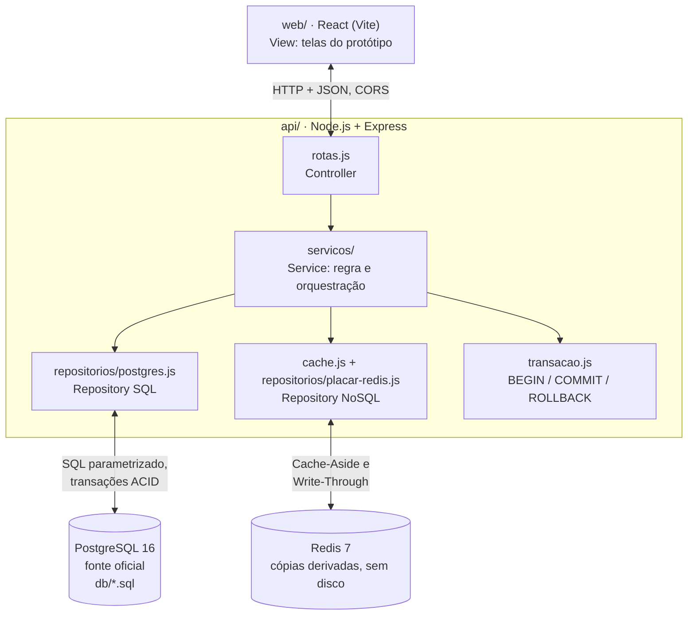
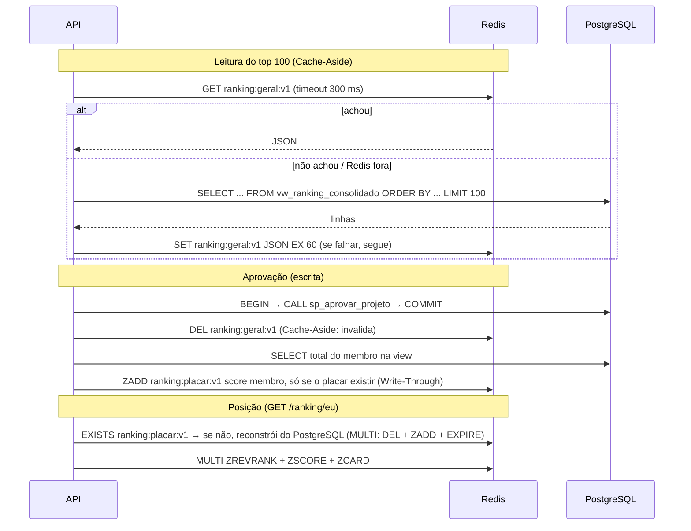

# 03 · Arquitetura

## Camadas (MVC/Layered, seção 3.1 da especificação de BD2 · DEC-002, DEC-013)

- Monólito em camadas, a arquitetura recomendada pela especificação de BD2 para o tempo do semestre.
- Só a API acessa os bancos. O front recebe JSON. CORS liberado só para as origens de `CORS_ORIGENS`.
- Docker Compose sobe `db`, `cache` e `api`. O front roda com `npm run dev` em `web/`.

## Divisão da persistência (justificativa poliglota)

| Dado | Fonte oficial | Redis | Por quê |
|---|---|---|---|
| Usuários, vínculos, trilhas, conteúdo, matrículas | PostgreSQL | nada | Estruturado, relacionado, precisa de integridade |
| Tentativas, respostas, resultados | PostgreSQL | nada | Histórico auditável (RNF07) |
| Conclusões e pontos | PostgreSQL | nada | Regra crítica: ACID, trigger e procedure |
| Top 100 do ranking | `vw_ranking_consolidado` | `ranking:geral:v1` · string JSON · TTL 60 s · **Cache-Aside** | Igual para todos, lido muito, muda pouco |
| Posição de cada participante | `vw_ranking_consolidado` | `ranking:placar:v1` · Sorted Set · TTL 10 min · **Write-Through** | Posição em O(log N) sem numerar o ranking inteiro |
| Senhas, gabaritos, pareceres | PostgreSQL (acesso restrito) | nunca | Sensível; não é cópia descartável |

Nada no Redis é necessário para reconstruir o sistema (constituição, item 2). O Redis roda sem
disco (`--save "" --appendonly no`): reiniciado, volta vazio e tudo é refeito do PostgreSQL.

Modelo chave-valor completo ("diagrama de coleções"): `docs/arquitetura-e-modelagem.md`.

## Banco relacional (resumo do modelo)

16 tabelas, normalizadas até a 3FN (ER completo em `docs/arquitetura-e-modelagem.md`):
`usuario`, `diretoria`, `vinculo_diretoria`, `trilha`, `modulo`, `licao`, `matricula`,
`avaliacao`, `questao`, `alternativa`, `participacao_avaliacao`, `tentativa_avaliacao`,
`resposta_tentativa`, `resultado_tentativa`, `conclusao`, `pontuacao`.

Objetos programáveis (prefixos da aula 5 de BD2, DEC-011):

| Objeto | Papel |
|---|---|
| `vw_ranking_consolidado` | Total de pontos e última concessão por usuário ativo |
| `vw_progresso_membro` | Avaliações exigidas x concluídas por matrícula |
| `vw_fila_avaliacao` | Entregas de desafio sem parecer, com a diretoria (fila do gestor, tela 10) |
| `sp_aprovar_projeto(...)` | Trava a participação (`FOR UPDATE`), confere permissão e estado, grava resultado e conclusão |
| `sp_pedir_ajustes(...)` | Mesma trava e validação; grava resultado "ajustes" com parecer obrigatório |
| `sp_enviar_projeto(...)` | Cria a participação na 1ª vez, aplica RN06, RN07 e RN08 e numera a tentativa |
| `sp_responder_quiz(...)` | Valida as respostas, grava tentativa e respostas, corrige no servidor, grava resultado e, se aprovado, conclusão (RF06) |
| `fn_autenticar(email, senha)` | Confere a senha com `crypt()` (bcrypt, extensão `pgcrypto`) e devolve o id do usuário ativo (RF01) |
| `trg_conclusao_pontua` | `AFTER INSERT` em conclusão: insere a pontuação na mesma transação |
| `trg_resultado_imutavel`, `trg_conclusao_imutavel`, `trg_pontuacao_imutavel` | `BEFORE UPDATE OR DELETE`: recusam alteração do histórico (RN18) |
| `fn_pode_avaliar`, `fn_travar_tentativa`, `fn_validar_avaliador` | Funções auxiliares das procedures |
| `idx_tentativa_enviada_em` | Índice medido com e sem (RNF05). Substituiu `idx_tentativa_participacao_data` (DEC-010) |

Erros das procedures usam SQLSTATE próprio, traduzido pela API (`api/src/erros.js`):
`EJ400` → 400 · `EJ403` → 403 · `EJ404` → 404 · `EJ409` → 409.

## Contrato da API (P0)

Toda rota protegida exige `Authorization: Bearer <token>`, obtido em `POST /login` (DEC-014). Em modo
demonstração (`PERMITIR_CABECALHO_USUARIO=1`, padrão local) também aceita `X-Usuario-Id`, usado pelos
scripts de teste e de medição. Erros sempre em JSON `{ "erro": "..." }`.
Evidência de cada linha: `docs/resultados/testes-api.txt` (`scripts/testar-api.sh`).

| Método e rota | Entrada | Saída 200 | Erros |
|---|---|---|---|
| `GET /saude` | - | `{ api, postgres, redis }` | 503 se o Postgres cair |
| `POST /login` | `{ email, senha }` | `{ token, expira_em, usuario }` | 400 faltou campo · 401 e-mail ou senha incorretos, ou desligado |
| `POST /logout` | - | 204 (o cliente descarta o token) | - |
| `GET /eu` | - | `{ id_usuario, nome, email, gestor_geral, vinculos, matriculas }` | 401 |
| `GET /eu/portfolio` | - | `{ projetos: [{ trilha, avaliacao, link_projeto, parecer, avaliador, aprovado_em, pontos }] }` (RF10) | 401 |
| `GET /trilhas/:id` | - | `{ id_trilha, titulo, id_matricula, modulos: [{ licoes, avaliacoes: [{ concluida, tentativas }] }] }` | 403 sem matrícula nem gestão · 404 |
| `GET /avaliacoes/:id` | - | quiz com `questoes` e `alternativas`, **sem** gabarito | 403 · 404 |
| `POST /avaliacoes/:id/respostas` | `{ respostas: [{ id_questao, alternativa }] }` | 201 `{ id_tentativa, percentual, decisao, ranking_invalidado, placar_atualizado }` | 400 resposta faltando ou inválida · 403 sem matrícula · 409 quiz já aprovado (RN07) ou é desafio |
| `GET /ranking` | - | `{ origem: "cache"\|"postgres", gerado_em, total_participantes, participantes: [{ posicao, id_usuario, nome, total_pontos, ultima_concessao }] }` (top 100) | 401 sem usuário · 503 se Postgres cair e não houver cache |
| `GET /ranking/eu` | - | `{ origem: "redis"\|"redis (placar reconstruído)"\|"postgres", id_usuario, posicao, total_pontos, total_participantes }` (`posicao: null` = sem pontos) | 401 |
| `POST /avaliacoes/:id/tentativas` | `{ link_projeto, descricao_entrega }` | 201 `{ id_tentativa, numero }` | 400 link inválido · 403 sem matrícula · 409 quizzes pendentes (RN06), desafio já aprovado (RN07) ou envio aguardando (RN08) |
| `POST /tentativas/:id/aprovar` | `{ parecer }` | `{ status: "aprovada"\|"ja_aprovada", ranking_invalidado, placar_atualizado }` | 403 autoaprovação ou fora do escopo · 404 · 409 tentativa já avaliada ou quiz |
| `POST /tentativas/:id/ajustes` | `{ parecer }` (obrigatório) | `{ status: "ajustes", ranking_invalidado: false, placar_atualizado: false }` | 400 sem parecer · 403 · 404 · 409 |
| `GET /matriculas/:id/progresso` | - | `{ id_matricula, trilha, exigidas, concluidas, percentual, proxima }` (`proxima: null` = trilha concluída) | 403 não é o dono nem gestor · 404 |
| `GET /fila` | - | `{ entregas: [...] }` aguardando parecer no escopo do gestor, mais antigas primeiro (50) | 401 |
| qualquer outra | - | - | 404 `{ "erro": "Rota não encontrada" }` |

Rotas P1 (telas restantes de PW1) estão no mapa da página "Fluxos e notas" do Figma.

## Sincronização SQL → NoSQL

