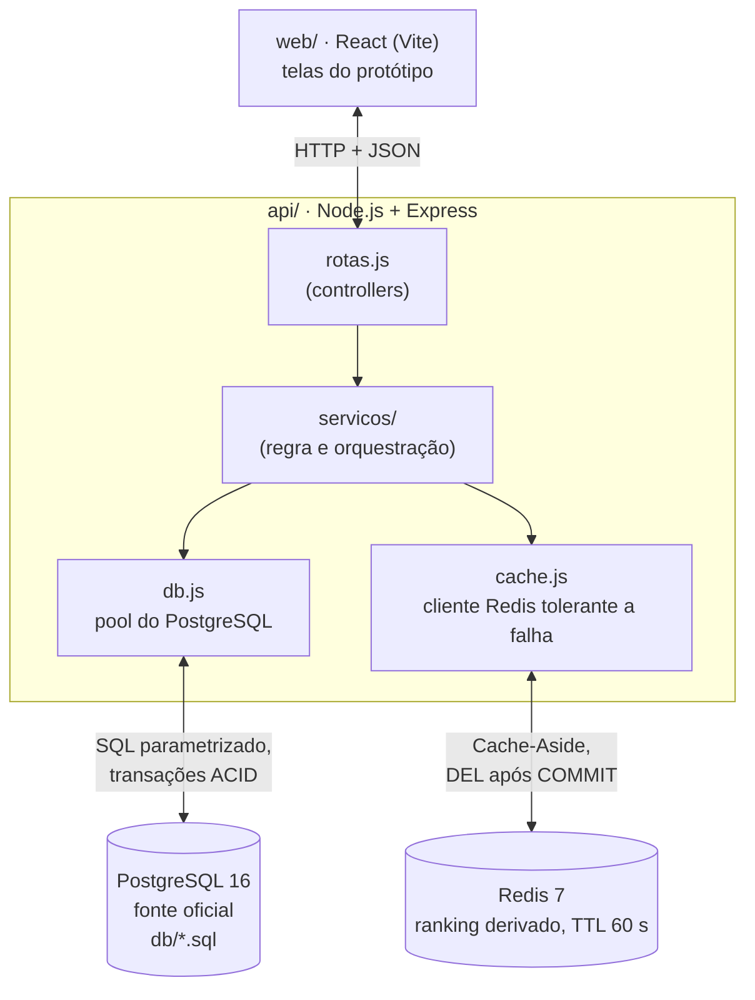
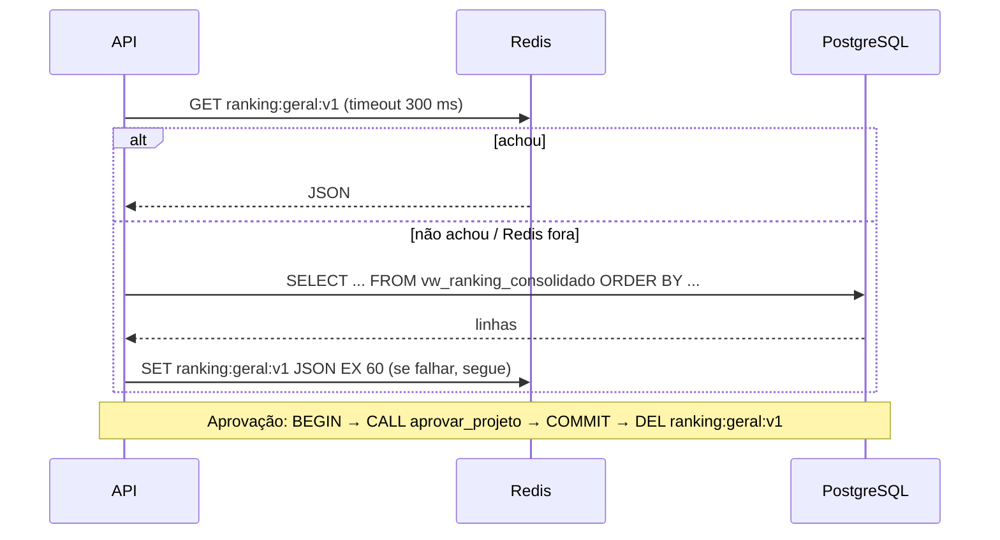

# 03 · Arquitetura

## Camadas

- Monólito em camadas (arquitetura MVC/Layered recomendada na especificação de BD2). DEC-002.
- Só a API acessa os bancos. O front recebe JSON.
- Docker Compose sobe `db`, `cache` e `api`. O front roda com `npm run dev` em `web/`.

## Divisão da persistência

| Dado | Fonte oficial | Redis |
|---|---|---|
| Usuários, vínculos, trilhas, conteúdo, matrículas | PostgreSQL | nada |
| Tentativas, respostas, resultados | PostgreSQL | nada |
| Conclusões e pontos | PostgreSQL | nada |
| Ranking geral | `vw_ranking_consolidado` | `ranking:geral:v1` (string JSON, TTL 60 s) |
| Senhas, gabaritos, pareceres | PostgreSQL (acesso restrito) | nunca |

## Banco relacional (resumo do modelo)

16 tabelas, normalizadas até a 3FN (ER completo no manual, capítulo 1):
`usuario`, `diretoria`, `vinculo_diretoria`, `trilha`, `modulo`, `licao`, `matricula`,
`avaliacao`, `questao`, `alternativa`, `participacao_avaliacao`, `tentativa_avaliacao`,
`resposta_tentativa`, `resultado_tentativa`, `conclusao`, `pontuacao`.

Objetos programáveis:

| Objeto | Papel |
|---|---|
| `vw_ranking_consolidado` | Total de pontos e última concessão por usuário ativo |
| `vw_progresso_membro` | Avaliações exigidas x concluídas por matrícula |
| `aprovar_projeto(...)` (procedure) | Trava a participação (`FOR UPDATE`), confere estado, grava resultado e conclusão |
| `trg_conclusao_pontua` (trigger) | Ao inserir conclusão, insere a pontuação na mesma transação |
| `idx_tentativa_participacao_data` | Índice medido com e sem (RNF05) |

## Contrato da API (P0)

Toda rota protegida exige `X-Usuario-Id` (simulado, DEC-004). Erros sempre em JSON `{ "erro": "..." }`.

| Método e rota | Entrada | Saída 200 | Erros |
|---|---|---|---|
| `GET /saude` | - | `{ api, postgres }` | 503 se o Postgres cair |
| `GET /ranking` | - | `{ origem: "cache"\|"postgres", gerado_em, participantes: [{ posicao, id_usuario, nome, total_pontos }] }` | 503 se Postgres cair e não houver cache |
| `POST /avaliacoes/:id/tentativas` | `{ link_projeto, descricao_entrega }` | `{ id_tentativa, numero }` | 409 já existe tentativa aguardando (RN08) ou participação concluída (RN07) |
| `POST /tentativas/:id/aprovar` | `{ parecer }` | `{ status: "aprovada"\|"ja_aprovada", ranking_invalidado }` | 403 autoaprovação ou fora do escopo · 409 tentativa já avaliada |
| `POST /tentativas/:id/ajustes` | `{ parecer }` | `{ status: "ajustes" }` | 403 · 409 |
| `GET /matriculas/:id/progresso` | - | `{ exigidas, concluidas, percentual, proxima }` | 404 |

Rotas P1 (telas restantes) estão no mapa da página "Fluxos e notas" do Figma.

## Cache-Aside (leitura) e invalidação (escrita)

