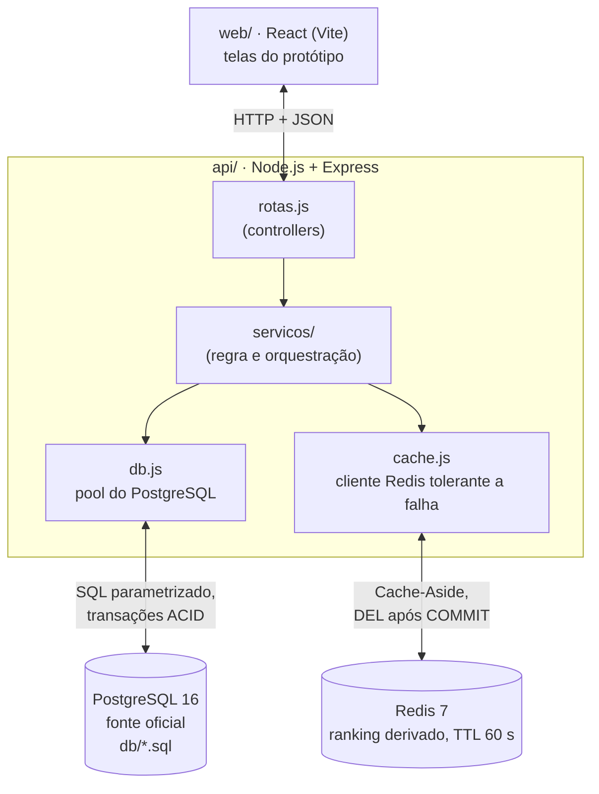
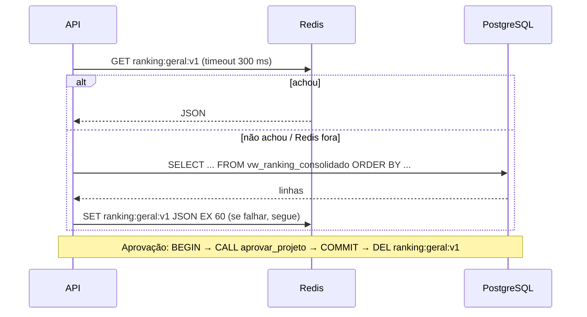

# 03 · Arquitetura

## Camadas

- Monólito em camadas (arquitetura MVC/Layered recomendada na especificação de BD2). DEC-002.
- Só a API acessa os bancos. O front recebe JSON.
- Docker Compose sobe `db`, `cache` e `api`. O front roda com `npm run dev` em `web/`.

## Divisão da persistência

| Dado | Fonte oficial | Redis |
|---|---|---|
| Usuários, vínculos, trilhas, conteúdo, matrículas | PostgreSQL | nada |
| Tentativas, respostas, resultados | PostgreSQL | nada |
| Conclusões e pontos | PostgreSQL | nada |
| Ranking geral | `vw_ranking_consolidado` | `ranking:geral:v1` (string JSON, TTL 60 s) |
| Senhas, gabaritos, pareceres | PostgreSQL (acesso restrito) | nunca |

## Banco relacional (resumo do modelo)

16 tabelas, normalizadas até a 3FN (ER completo no manual, capítulo 1):
`usuario`, `diretoria`, `vinculo_diretoria`, `trilha`, `modulo`, `licao`, `matricula`,
`avaliacao`, `questao`, `alternativa`, `participacao_avaliacao`, `tentativa_avaliacao`,
`resposta_tentativa`, `resultado_tentativa`, `conclusao`, `pontuacao`.

Objetos programáveis:

| Objeto | Papel |
|---|---|
| `vw_ranking_consolidado` | Total de pontos e última concessão por usuário ativo |
| `vw_progresso_membro` | Avaliações exigidas x concluídas por matrícula |
| `vw_fila_avaliacao` | Entregas de desafio sem parecer, com a diretoria (fila do gestor, tela 10) |
| `aprovar_projeto(...)` (procedure) | Trava a participação (`FOR UPDATE`), confere permissão e estado, grava resultado e conclusão |
| `pedir_ajustes(...)` (procedure) | Mesma trava e validação; grava resultado "ajustes" com parecer obrigatório |
| `enviar_projeto(...)` (procedure) | Cria a participação na 1ª vez, aplica RN06, RN07 e RN08 e numera a tentativa |
| `trg_conclusao_pontua` (trigger) | Ao inserir conclusão, insere a pontuação na mesma transação |
| `idx_tentativa_enviada_em` | Índice medido com e sem (RNF05). Substituiu `idx_tentativa_participacao_data` (DEC-010) |

Erros das procedures usam SQLSTATE próprio, traduzido pela API (`api/src/erros.js`):
`EJ400` → 400 · `EJ403` → 403 · `EJ404` → 404 · `EJ409` → 409.

## Contrato da API (P0)

Toda rota protegida exige `X-Usuario-Id` (simulado, DEC-004). Erros sempre em JSON `{ "erro": "..." }`.
Evidência de cada linha: `docs/resultados/testes-api.txt` (`scripts/testar-api.sh`).

| Método e rota | Entrada | Saída 200 | Erros |
|---|---|---|---|
| `GET /saude` | - | `{ api, postgres, redis }` | 503 se o Postgres cair |
| `GET /ranking` | - | `{ origem: "cache"\|"postgres", gerado_em, total_participantes, participantes: [{ posicao, id_usuario, nome, total_pontos, ultima_concessao }] }` (top 100) | 401 sem usuário · 503 se Postgres cair e não houver cache |
| `POST /avaliacoes/:id/tentativas` | `{ link_projeto, descricao_entrega }` | 201 `{ id_tentativa, numero }` | 400 link inválido · 403 sem matrícula · 409 quizzes pendentes (RN06), desafio já aprovado (RN07) ou envio aguardando (RN08) |
| `POST /tentativas/:id/aprovar` | `{ parecer }` | `{ status: "aprovada"\|"ja_aprovada", ranking_invalidado }` | 403 autoaprovação ou fora do escopo · 404 · 409 tentativa já avaliada ou quiz |
| `POST /tentativas/:id/ajustes` | `{ parecer }` (obrigatório) | `{ status: "ajustes", ranking_invalidado: false }` | 400 sem parecer · 403 · 404 · 409 |
| `GET /matriculas/:id/progresso` | - | `{ id_matricula, trilha, exigidas, concluidas, percentual, proxima }` (`proxima: null` = trilha concluída) | 403 não é o dono nem gestor · 404 |
| `GET /fila` | - | `{ entregas: [...] }` aguardando parecer no escopo do gestor, mais antigas primeiro (50) | 401 |

Rotas P1 (telas restantes) estão no mapa da página "Fluxos e notas" do Figma.

## Cache-Aside (leitura) e invalidação (escrita)

